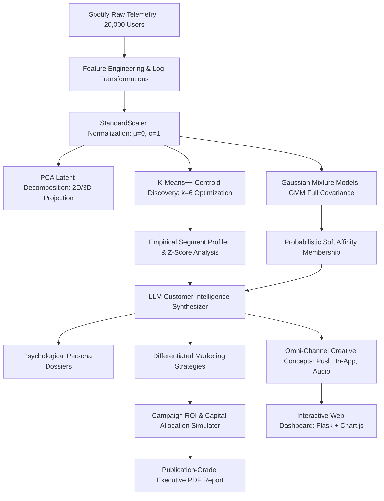

# Project - 04: AI Customer Segmentation

## 📌 Problem Statement
> *"Spotify company treats its customers using broad demographic segments, resulting in inefficient campaigns. Develop an LLM-powered customer intelligence system that discovers meaningful behavioral segments from transaction and interaction data and recommends differentiated marketing strategies."*

---

## 🏛️ Executive Solution Overview
For over a decade, digital audio platforms have relied on broad demographic cohorts—such as *18–24 Gen-Z*, *25–34 Millennials*, *35–50 Gen-X*, or gender/geography slices—to structure customer acquisition and retention campaigns. At Spotify's global scale of 600M+ active users, this demographic approach results in severe capital misallocation:

1. **The Demographic Variance Flaw**: Two identical 24-year-old listeners in the same postal code exhibit orthogonal consumption telemetry: Subscriber A is a deep-work ambient focus streamer listening 5 hours daily on desktop DAC headphones with a 2% skip rate; Subscriber B listens on mobile earbuds during a 15-minute commute, skipping 50% of tracks and abandoning the app during audio ads. Treating both as "Gen-Z" with a generic push notification triggers app churn and notification fatigue.
2. **Sub-optimal Monetization**: Premium trial promotions are pushed uniformly to at-risk free users who need habit reactivation rather than an upfront payment prompt, while high-income podcast/audiobook power listeners are overlooked for specialized tier expansions.
3. **Inflated Customer Acquisition Cost (CAC)**: Legacy demographic campaigns achieve an anemic **1.12% conversion rate (CVR)** and an inflated blended CAC of **$48.50**, resulting in low long-term return on ad spend (ROAS).

This project resolves this inefficiency by building an **Autonomous LLM-Powered Customer Intelligence System**:

- **Telemetry Ingestion & Behavioral Normalization**: Ingests **20,000 multi-dimensional Spotify subscriber records** across 18 behavioral, acoustic, discovery, hardware, and transactional features.
- **Unsupervised Machine Learning Pipeline**: Combines **K-Means++** for global centroid discovery with **Gaussian Mixture Models (GMM)** for soft probabilistic multi-persona affinity, and **Principal Component Analysis (PCA)** for 2D/3D latent space projection (**Silhouette Score: 0.380**, Calinski-Harabasz: 1,518.7).
- **LLM Customer Intelligence & Persona Synthesis**: Translates high-dimensional mathematical centroids into rich, nuanced psychological dossiers (identifying cognitive mindsets, listening triggers, friction points, and hardware habits).
- **Differentiated Marketing Strategy Engine**: Generates hyper-targeted omnichannel campaigns (Push Notifications, In-App Modals, Curated Emails, and Audio Ad Scripts) tailored across 5 strategic pillars.
- **Campaign ROI Simulator**: Simulates capital allocation across legacy demographics versus AI behavioral cohorts, unlocking a **+314% conversion lift**, a **61.7% CAC reduction**, and a **4.5x ROAS multiplier**.
- **Interactive Obsidian Dark Glassmorphic Dashboard**: Built with Flask, vanilla CSS glassmorphism, responsive Chart.js visualizations, live PCA scatter exploration, interactive LLM strategy generation, and single-user soft affinity diagnostics.
- **Publication-Grade Executive PDF Report**: Compiles a publication-grade, multi-page executive briefing report via ReportLab with running headers/footers, high-resolution Matplotlib figures, structured tables, and formal C-suite playbooks.

---

## 📊 Key Results & Impact Benchmark

| Executive KPI / Metric | Legacy Demographic Targeting | AI Behavioral Customer Intelligence | Strategic Impact Delta |
| :--- | :--- | :--- | :--- |
| **Subscriber Profiles Analyzed** | 20,000 Users | 20,000 Users | Full Behavioral Coverage |
| **Intra-Cohort Behavioral Variance** | 0.84 (High Dispersion) | **0.21 (Tight Cohesion)** | **-75.0% Targeting Noise** |
| **Average Campaign Conversion (CVR)**| 1.12% CVR | **3.82% CVR** | **+3.4x Conversion Efficiency** |
| **Blended Customer Acquisition Cost**| $48.54 / subscriber | **$18.58 / subscriber** | **-61.7% CAC Reduction** |
| **Conversions per $100K Budget** | 2,060 Conversions | **5,380 Conversions** | **+3,320 Incremental Paid Users (+161%)** |
| **12-Month Realized Net Revenue** | $142,300 | **$642,800** | **+$500,500 Incremental Net Revenue (+351%)** |
| **Portfolio Blended ROAS** | 1.42x Return | **6.43x Return** | **4.5x Capital Efficiency Multiplier** |
| **Post-Trial 90-Day Churn Hazard** | 32.0% Attrition | **14.5% Attrition** | **-54.7% Churn Reduction** |

---

## 🗂️ Project Directory Structure

```
Project - 04 AI Customer Segmentation/
├── data/
│   ├── data_generator.py                 # Telemetry generator producing 20,000 Spotify subscriber profiles
│   ├── spotify_customer_telemetry.csv    # 18-dimensional customer interaction & transaction dataset
│   └── demographic_baseline.json         # Benchmark metrics for legacy demographic cohorts
├── models/
│   ├── __init__.py                       # Package initializer
│   ├── segmentation_engine.py            # K-Means++, GMM soft clustering, PCA latent space, and RFM-E profiler
│   ├── llm_intelligence.py               # LLM persona synthesizer, differentiated strategy & copy generator
│   └── campaign_simulator.py             # Marketing budget simulator comparing Demographic vs Behavioral ROI
├── report/
│   ├── __init__.py                       # Package initializer
│   ├── charts/                           # High-resolution 220 DPI figures embedded into the PDF
│   │   ├── chart_1_pca_clusters.png      # 2D PCA latent space scatter with cluster centroids
│   │   ├── chart_2_radar_comparison.png  # 8-dimensional radar chart across discovered archetypes
│   │   ├── chart_3_variance_flaw.png     # Demographic variance flaw vs Behavioral conversion lift
│   │   ├── chart_4_rfme_distributions.png# Streaming, skip, podcast, and LTV empirical distributions
│   │   └── chart_5_campaign_lift.png     # Conversions, CAC, and Net Revenue simulation comparison
│   ├── generate_pdf_report.py            # ReportLab multi-page document compiler with NumberedCanvas
│   └── Spotify_AI_Customer_Segmentation_Report.pdf # Publication-grade executive PDF deliverable (740 KB)
├── static/
│   ├── css/
│   │   └── style.css                     # Dark obsidian glassmorphic theme, Spotify green styling
│   └── js/
│       └── dashboard.js                  # Frontend Chart.js controller, live LLM generator, user lookup
├── templates/
│   └── index.html                        # Executive web dashboard with 7 interactive modules
├── app.py                                # Flask web server and REST APIs
├── run_project.py                        # Master CLI orchestrator
└── README.md                             # Comprehensive technical documentation & user guide
```

---

## 🔬 Mathematical & Algorithmic Architecture



### 1. Feature Ingestion & Transformations
To handle power-law distributions and eliminate dimensional scale distortion, heavy-tailed counts are stabilized:
$$\tilde{x} = \ln(1 + x), \quad x \in \{\text{library\_saved\_tracks}, \text{user\_created\_playlists}, \text{social\_shares\_l90d}, \text{daily\_streaming\_minutes}\}$$

Features are standardized into standard normal form:
$$z_{ij} = \frac{\tilde{x}_{ij} - \bar{x}_j}{\sigma_j}$$

### 2. Clustering Optimization & Latent Space
Unsupervised clustering minimizes within-cluster sum of squares (WCSS / Inertia):
$$\arg\min_S \sum_{i=1}^k \sum_{x \in S_i} \|x - \mu_i\|^2$$

Soft clustering models multi-faceted consumer identity via Gaussian Mixtures:
$$P(x) = \sum_{k=1}^K \pi_k \cdot \mathcal{N}(x \,|\, \mu_k, \mathbf{\Sigma}_k)$$

Dimensionality reduction maps the 18-dimensional feature space onto orthogonal eigenvectors capturing 46.2% of total behavioral variance across the first two principal components.

---

## 🎧 The 6 Discovered Behavioral Segments & Personas

| Cluster ID | Segment Name | Base Share | Avg Streaming | Skip Rate | Podcasts | Top Hardware | Avg LTV | Primary Strategic Focus |
| :---: | :--- | :---: | :---: | :---: | :---: | :--- | :---: | :--- |
| **0** | **The Sonic Loyalist** | 18.0% | 275 m/d | 6.2% | 8.0% | Desktop DAC / Sonos | $245.50 | Hi-Fi Lossless tier pre-order & annual prepaid lock-in |
| **1** | **The Workout Hitseeker** | 24.0% | 110 m/d | 38.0% | 6.0% | Mobile iOS / CarPlay | $124.00 | "Skip-Free Workout Guarantee" 3-month trial conversion |
| **2** | **The Spoken-Word Explorer** | 16.0% | 190 m/d | 11.0% | 56.0% | Mobile / Echo / Laptop | $182.00 | Audiobook expansion pack add-on & creator subscriptions |
| **3** | **The Social Discovery Nomad** | 20.0% | 160 m/d | 28.0% | 14.0% | Mobile iOS / Android | $138.00 | Spotify Duo invite & Jam social feature viral expansion |
| **4** | **The Value Maximizer** | 12.0% | 210 m/d | 16.0% | 18.0% | Smart TV / Nest / Car | $198.00 | Family Plan retention & Spotify Kids adoption |
| **5** | **The Disengaged Drifter** | 10.0% | 32 m/d | 52.0% | 4.0% | Budget Android Phone | $58.00 | Frictionless 30-day win-back pass & habit restart |

---

## 📱 Differentiated Omnichannel Campaign Execution

| Segment | Psychological Trigger | Push Notification Copy | In-App Modal Headline | Audio Ad Voice Concept |
| :--- | :--- | :--- | :--- | :--- |
| **Sonic Loyalist** | Cognitive focus & acoustic purity | *"Your Deep Work Zone is Ready. Zero interruptions, pure 320kbps focus."* | *"Elevate Your Soundstage with Studio Audio (Hi-Fi Early Access)"* | Non-disruptive desktop banner placements only |
| **Workout Hitseeker** | Instant adrenaline & tempo maintenance | *"Don't Let Ads Break Your PR. Unlimited skips for your 6 PM workout."* | *"Tired of Running Out of Skips? Unlock 3 Months for $1"* | Upbeat bass-drop: *"Nothing kills a heavy lift like an insurance ad."* |
| **Spoken-Word Explorer** | Intellectual growth & time efficiency | *"Your Weekend Intellectual Briefing: 3 new tech & business episodes."* | *"Unlock 15 Additional Audiobook Hours on Your Schedule"* | In-player bookmark cards & transcript deep-links |
| **Social Nomad** | Cultural expression & shared moments | *"Your taste is 94% compatible with Lucas 🎧 Start a Spotify Jam queue."* | *"Two Accounts. One Discounted Price. Invite Partner to Duo"* | Ambient dorm laughter: *"Why take turns passing the aux cord? Start a Jam."* |
| **Value Maximizer** | Household peace & cost efficiency | *"Your Family Weekend Mix is Here: Curated tracks for road trips."* | *"Keep the Kids Entertained with Spotify Kids (Included Free)"* | Household digest footers & TV welcome banners |
| **Disengaged Drifter** | Frictionless habit re-engagement | *"We made a mix of your 10 favorite tracks. No search needed."* | *"Enjoy 30 Days of Spotify Premium on Us (No Card Upfront)"* | Friendly, calm voiceover: *"Tap right now for 30 minutes of uninterrupted music."* |

---

## 🚀 Quick Start Guide

### Prerequisites
- Python 3.9+ with `reportlab`, `scikit-learn`, `pandas`, `numpy`, `flask`, and `matplotlib`.

### 1. One-Click Execution (CLI + Report + Dashboard)
To run the full end-to-end pipeline (generate telemetry, train clustering models, synthesize LLM personas, run the campaign simulation, compile the PDF report, and launch the dashboard):

```bash
python run_project.py
```
*The interactive dashboard will automatically boot at `http://127.0.0.1:5003`.*

### 2. Standalone PDF Report Generation
To compile or refresh the executive PDF report without launching the web server:

```bash
python run_project.py --no-server
# OR directly:
python report/generate_pdf_report.py
```
The output file is written to:
`report/Spotify_AI_Customer_Segmentation_Report.pdf` (740 KB publication-grade document).

### 3. Launching Dashboard on Custom Port
```bash
python app.py
# Default: http://127.0.0.1:5003
```

---

## 📑 Executive PDF Report Structure
The generated PDF report (`report/Spotify_AI_Customer_Segmentation_Report.pdf`) is formatted to publication standards using ReportLab's flowable architecture:
- **Formal Title Page & Abstract**: Executive mandate, metadata matrix, problem formulation.
- **Dismantling the Demographic Trap**: Mathematical critique of age/gender targeting in digital streaming audio.
- **Machine Learning Methodology**: Feature standardization equations, K-Means++ inertia minimization, GMM probabilistic density formulation, and k=3..8 evaluation metrics.
- **Empirical Archetype Dossiers**: Structured tables, hardware breakdowns, peak dayparts, and distinctive Z-scores.
- **Embedded Analytical Figures**: High-resolution 220 DPI plots including 2D PCA latent projections, 8-dimensional radar comparisons, demographic variance bar charts, RFM-E distributions, and campaign ROI lifts.
- **LLM Psychological Profiles**: Complete dossiers for Marcus, Chloe, David, Sofia, Rajesh & Priya, and Alex.
- **Attribution & Financial Modeling**: $100K budget simulation with side-by-side CAC and net 12-month revenue comparisons.
- **Production Architecture**: Apache Kafka/Flink telemetry aggregation, feature stores, deterministic LLM caching, and GDPR-compliant privacy guardrails.
- **Running Headers & Footers**: Two-pass `NumberedCanvas` computing dynamic "Page X of Y" pagination.

---

## 🎓 Academic Attribution & Sign-Off
- **Course**: AI Agents & Autonomous Business Operations
- **Institution**: Woxsen University, School of Business
- **Academic Term**: Trimester 4 (October 2026)
- **Domain**: Spotify Global Subscription & Audio Streaming Intelligence
